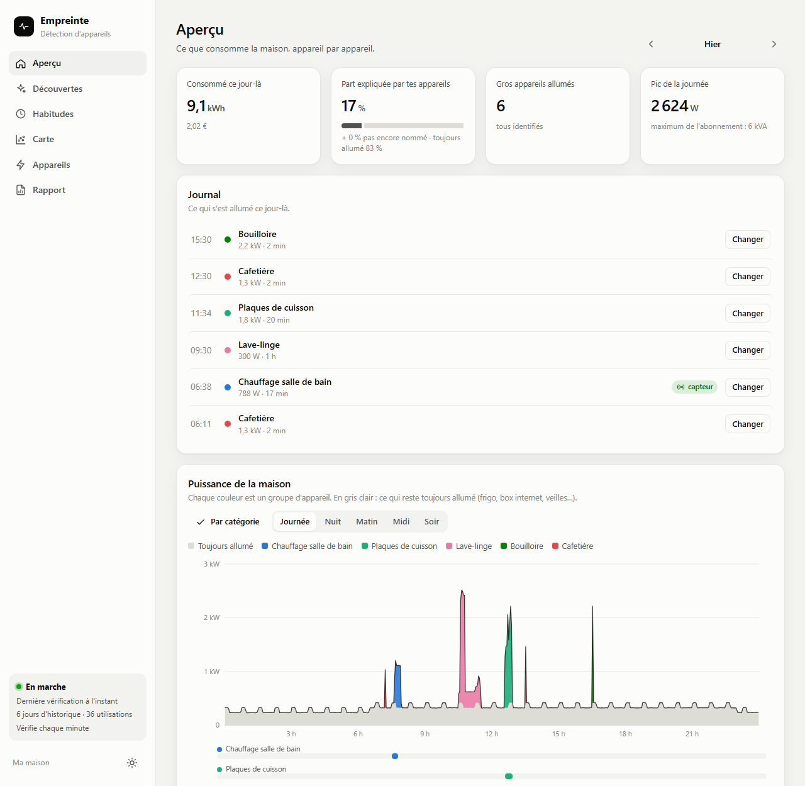

  

<h1 align="center">Empreinte</h1>

  <b>See what every appliance in your home consumes, from a single whole-house power sensor.</b> 
  100 % local appliance detection (NILM) for Home Assistant: oven, hob, kettle, dishwasher, heater…

  

  
  
  
  

  <a href="README.md">Français</a> · <b>English</b>

---

Empreinte (French for *footprint*) watches the power of your **whole house** (a French Linky meter, a Shelly EM, a clamp meter…) and **recognises the big appliances** as they switch on. No smart plug to buy, no cloud: everything runs inside your Home Assistant and nothing leaves your home.

> **Note:** the Empreinte panel and its texts are currently in **French**. The setup screens are in English and French. An English panel is planned; contributions are welcome.

Screenshots made with an imaginary house.

## Why Empreinte?

- **One sensor is enough**: the live power of the house. Linky (ZLinky, Lixee, TIC), Shelly EM / 3EM, Zigbee clamp…
- **It learns from you**: name an appliance once or twice, then it recognises it on its own, better and better.
- **Fills the Home Assistant Energy dashboard**: each recognised appliance becomes a power and energy sensor you add in one click.
- **Savings in euros**: standby, heating, dishwasher programmes, air conditioning. The tips are computed from your real consumption.
- **100 % local and private**: no account, no server, no data sent anywhere. Uninstalling removes everything.
- **Free and open source** (MIT).

## How it works

1. **Detect.** Every sudden rise of more than 350 W means something switched on. Empreinte records its power, duration and shape: steady (kettle), thermostat (oven), steps (hob).
2. **Group.** Similar switch-ons become "discoveries": "about 2 kW, 3 minutes, several times a day".
3. **You name.** One click: "it's the kettle". You can also say live "this is the dishwasher right now", and it tracks it to the end, even among other appliances.
4. **Recognise.** It shows its confidence as a percentage. When it is sure enough, **you** decide to add it to the Energy dashboard.

### You stay in control

Your appliance is not in the list (pool pump, aquarium, hot tub, EV charger…)? **Just type its name**: it becomes a new appliance that Empreinte learns like the others.

Nothing is set in stone: an appliance you added can be **renamed**, **deleted**, **merged** with another or **split** in two. A misfiled use can be **moved**, and Empreinte recomputes the past. Any appliance or category can be **removed from the Energy dashboard** in one click, and the last action can be **undone**.

## Installation

### With HACS (recommended)

1. In **HACS**, search for **Empreinte**, then **Download**. (The **"Open in HACS"** button above takes you straight there.)
2. **Restart Home Assistant**.
3. , or **Settings → Devices & services → Add integration → Empreinte**.
4. Pick the **whole-house power** sensor (W or VA). Empreinte usually guesses it for you.

Empreinte not in the HACS search yet? Add it by hand: ⋮ → **Custom repositories** → `https://github.com/nodyxstudio/empreinte-nilm-home-assistant`, category **Integration**.

### Manually

Download `empreinte.zip` from the [latest release](https://github.com/nodyxstudio/empreinte-nilm-home-assistant/releases/latest), unzip it into `config/custom_components/empreinte/`, restart, then follow step 3.

**Empreinte** then appears in the sidebar. It also reads back the last 10 days of Home Assistant history, so it often has discoveries to show right away.

## Optional settings

**Settings → Devices & services → Empreinte → Configure.** Change them any time.

| Setting | What it does |
|---|---|
| **Smart plugs that already measure a device** | Their power is subtracted before the analysis, so the PC or TV is never mistaken for something else. |
| **Air conditioner / heat pump** | Its compressor makes the curve go up and down: Empreinte ignores these small steps instead of inventing appliances. |
| **Its energy meter** | It then gets its own smoothed line in the daily balance. |
| **Fridge consumption** | kWh per year from its energy label. Too small to be seen, it is estimated and taken out of "unidentified". |
| **Other estimated meters** | For example [Powercalc](https://github.com/bramstroker/homeassistant-powercalc) meters (lights, router, alarm), taken out of "unidentified". |

### One plug, two appliances

Washing machine and dryer on the same smart plug, never on together? **Configure → Shared plugs**: pick the plug and type "Washing machine, Dryer". Empreinte reads the plug's own curve, cuts each programme and recognises **which one** ran (the washer first turns without heating, heats the water, then alternates motor and pauses; the dryer heats almost all the time from the start, or draws about 600 W for a heat-pump model, and its drum never stops). Each gets its own sensors (running, power, measured energy) and its line in the Energy dashboard. In **Appliances**, one click on the right name corrects a programme and Empreinte learns. Works with any appliances: for ones it does not know, confirm one programme of each.

## Requirements

- **Home Assistant** 2024.11 or newer.
- **A whole-house power sensor** updated every few seconds.
- For the balance and costs: the Home Assistant **Energy dashboard** set up with grid consumption and the kWh price.

## Your data stays at home

Everything is computed on your machine. Empreinte sends nothing to the internet: no account, no server, no telemetry. Its data lives in one file (`config/empreinte/empreinte.db`), included in Home Assistant backups.

## Uninstall

1. **Settings → Devices & services → Empreinte → ⋮ → Delete.** Everything Empreinte added is removed: sensors, Energy dashboard lines, their statistics and its data. The rest of your Home Assistant is untouched.
2. In HACS, **Empreinte → ⋮ → Remove** (or delete `config/custom_components/empreinte` if installed manually), then restart.

## Good to know

- Empreinte sees **appliances above 350 W**. Small ones stay in the always-on background.
- An appliance on for **less than 30 seconds** is often missed: the meter does not give enough readings.
- It needs **a few uses** of each appliance before being really sure.
- The hardest case: two appliances of similar power at the same time (oven and hob). That is what categories are for.

More: [FAQ (French)](docs/FAQ.md) · [Technical notes (French)](docs/TECHNIQUE.md) · [Contributing](CONTRIBUTING.md)

Questions or feedback? Write to **[nodyxstudio@gmail.com](mailto:nodyxstudio@gmail.com)**.

If Empreinte helps you, a ⭐ helps other homes find it.

Keywords: Home Assistant, NILM, non-intrusive load monitoring, energy disaggregation, appliance detection, per-device energy monitoring, Energy dashboard, Linky, Shelly EM, HACS custom integration.
