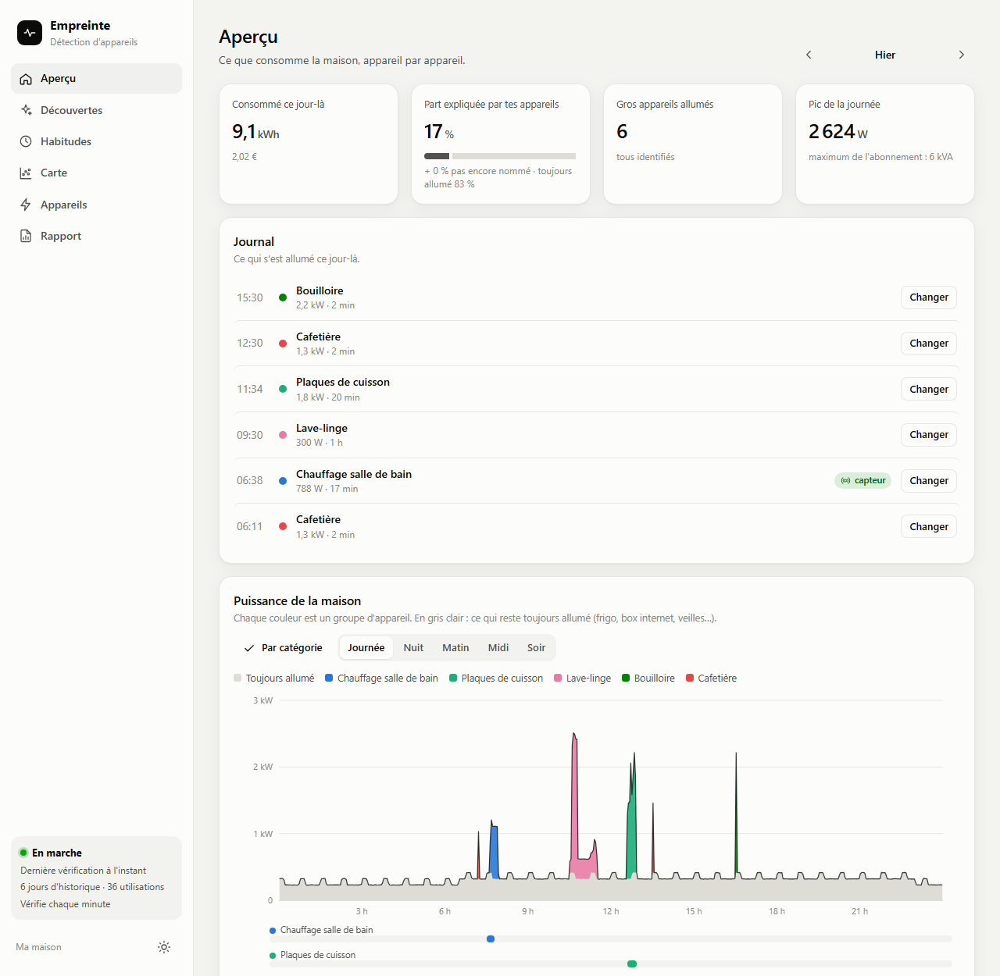
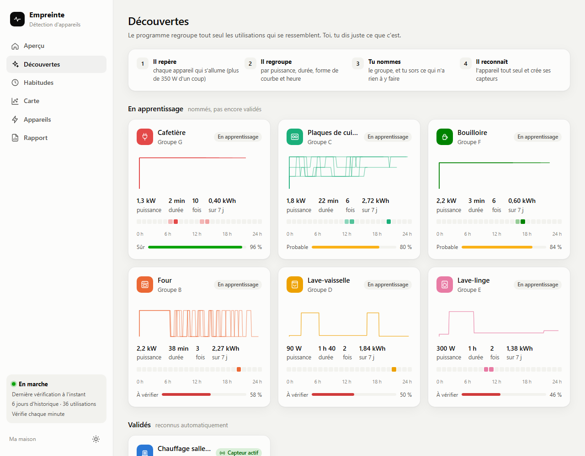
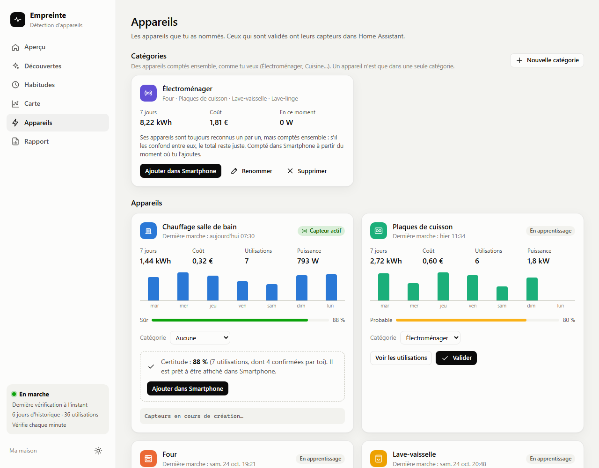

  

<h1 align="center">Empreinte</h1>

  <b>Savoir ce que consomme chaque appareil de la maison, à partir du seul compteur Linky.</b> 
  Détection d'appareils (NILM) 100 % locale pour Home Assistant : four, plaques, bouilloire, lave-vaisselle, chauffage…

  

  
  
  
  

  <b>Français</b> · <a href="README.en.md">English</a>

---

Empreinte regarde la consommation de **toute la maison** (celle que donne le compteur Linky, un Shelly EM ou une pince ampèremétrique) et **reconnaît les gros appareils** qui s'allument. Pas de prise connectée à acheter, pas de cloud : tout est calculé dans votre Home Assistant, et rien ne sort de chez vous.

Images faites avec une maison imaginaire.

## Pourquoi Empreinte ?

- **Un seul capteur suffit** : la puissance de la maison en direct. Linky (ZLinky, Lixee, TIC), Shelly EM, Shelly 3EM, pince Zigbee…
- **Il apprend de vous** : vous nommez un appareil une fois ou deux, il le reconnaît ensuite tout seul, de mieux en mieux.
- **Le tableau Énergie de Home Assistant se remplit** : chaque appareil reconnu devient un capteur de puissance et d'énergie, que vous ajoutez d'un clic.
- **Des économies chiffrées** : veilles, chauffage, programmes du lave-vaisselle, clim. Les conseils sont calculés sur votre vraie consommation, en euros par an.
- **100 % local et privé** : aucun compte, aucun serveur, aucune donnée envoyée. Désinstaller supprime tout.
- **Libre et gratuit** (licence MIT).

## Comment ça marche

1. **Il repère.** Chaque montée d'un coup de plus de 350 W, c'est quelque chose qui s'allume. Empreinte note sa puissance, sa durée et sa forme : stable (bouilloire), thermostat (four), paliers (plaques).
2. **Il regroupe.** Les allumages qui se ressemblent forment des « découvertes » : « environ 2 kW, 3 minutes, plusieurs fois par jour ».
3. **Vous nommez.** D'un clic : « c'est la bouilloire ». Vous pouvez aussi dire en direct « là, c'est le lave-vaisselle », et il le suit jusqu'à la fin, même au milieu d'autres appareils.
4. **Il reconnaît.** Il affiche sa certitude en pourcentage. Quand il est assez sûr, **vous** décidez de l'ajouter au tableau Énergie.

### Vous gardez la main

Vos appareils ne sont pas dans la liste (pompe de piscine, aquarium, spa, borne de recharge…) ? **Écrivez simplement leur nom** : ça crée un nouvel appareil, qu'Empreinte apprend comme les autres.

Rien n'est figé : un appareil ajouté se **renomme**, se **supprime**, se **fusionne** avec un autre ou se **sépare** en deux. Une utilisation mal rangée se **déplace** (« Non, c'est… »), et Empreinte refait ses calculs sur le passé. Un appareil ou une catégorie se **retire du tableau Énergie** d'un clic, et la dernière action s'**annule**.

## Ce qu'on y trouve

| | |
|---|---|
| **Journal** | Ce qui s'est allumé dans la journée, et ce qui tourne en ce moment |
| **Graphique du jour** | Une couleur par appareil, plus le fond toujours allumé |
| **Catégories** | « Électroménager » regroupe four, plaques, lave-vaisselle… : leur total reste juste même s'il les confond |
| **Habitudes** | À quelle heure et quel jour tourne chaque appareil |
| **Suivi des programmes** | Lave-vaisselle, four, lave-linge suivis du début à la fin, pauses comprises |
| **Bilan par jour** | La maison découpée ligne par ligne, avec le « non identifié », le frigo et les veilles estimés, et le coût de chaque ligne |
| **Économies** | Les gestes qui rapportent le plus, en € par an, et ce mois-ci comparé au précédent |

## Installation

### Avec HACS (recommandé)

1. Cliquez sur le bouton **« Ouvrir dans HACS »** en haut de cette page, ou, dans HACS, ⋮ → **Dépôts personnalisés** → ajoutez `https://github.com/nodyxstudio/empreinte-nilm-home-assistant`, catégorie **Intégration**.
2. Installez **Empreinte**, puis **redémarrez Home Assistant**.
3. , ou **Paramètres → Appareils et services → Ajouter une intégration → Empreinte**.
4. Choisissez le capteur de **puissance de la maison** (en W ou en VA). Empreinte le devine souvent tout seul.

### À la main

Téléchargez `empreinte.zip` dans la [dernière version](https://github.com/nodyxstudio/empreinte-nilm-home-assistant/releases/latest), dézippez-le dans `config/custom_components/empreinte/`, redémarrez, puis suivez l'étape 3.

**Empreinte** apparaît ensuite dans le menu de gauche. À la première ouverture, un court accueil explique les quatre étapes (le bouton **?** le rouvre). Laissez-le tourner quelques heures : les premières découvertes arrivent avec les premiers allumages. Il relit aussi les 10 derniers jours de l'historique de Home Assistant, donc il a souvent déjà de quoi proposer dès le départ.

👉 **Pas à pas, avec captures : [le tutoriel](docs/TUTORIEL.md).**

## Réglages (facultatifs)

**Paramètres → Appareils et services → Empreinte → Configurer.** Tout se change à tout moment.

| Réglage | À quoi ça sert |
|---|---|
| **Prises qui mesurent déjà un appareil** | Leur puissance est retirée avant l'analyse : le PC ou la télé ne sont jamais pris pour autre chose. |
| **Clim / pompe à chaleur** | Son compresseur fait monter et descendre la courbe : Empreinte ignore ces petits paliers au lieu d'inventer des appareils. |
| **Son compteur d'énergie** | Elle a alors sa propre ligne dans le bilan, lissée heure par heure. |
| **Consommation du frigo** | En kWh par an, sur son étiquette énergie. Trop discret pour être vu, il est estimé et retiré du « non identifié ». |
| **Autres compteurs estimés** | Par exemple des compteurs [Powercalc](https://github.com/bramstroker/homeassistant-powercalc) (lampes, box, alarme), retirés du « non identifié ». |

## Ce qu'il vous faut

- **Home Assistant** 2024.11 ou plus récent.
- **Un capteur de la puissance de toute la maison**, mis à jour toutes les quelques secondes. Avec un Linky : un module [ZLinky](https://lixee.fr) (Zigbee), un module TIC Wi-Fi, ou tout autre lecteur de téléinformation. Hors France : Shelly EM / 3EM, pince ampèremétrique, compteur Zigbee ou Modbus.
- Pour le bilan et les coûts : le **tableau Énergie** de Home Assistant réglé avec la consommation du réseau et le prix du kWh.

## Vos données restent chez vous

- Tout est calculé **sur votre machine**, dans Home Assistant.
- Empreinte **n'envoie rien sur internet** : pas de compte, pas de serveur, pas de statistiques d'utilisation.
- Les données tiennent dans un seul fichier (`config/empreinte/empreinte.db`), inclus dans les sauvegardes de Home Assistant.
- Supprimer l'intégration efface **tout ce qu'elle a ajouté** : ses capteurs, ses lignes du tableau Énergie, leurs statistiques et sa base de données. Le reste de votre Home Assistant n'est pas touché.

## Bon à savoir

- Empreinte voit les **appareils de plus de 350 W**. Les petits (chargeurs, lampes, box) restent dans le fond toujours allumé.
- Un appareil allumé **moins de 30 secondes** passe souvent inaperçu : le compteur ne donne pas assez de mesures.
- Il faut **quelques utilisations** de chaque appareil avant qu'il soit vraiment sûr de lui.
- Le cas le plus dur : deux appareils de puissance proche en même temps (four et plaques). C'est pour ça que les catégories existent.
- Le capteur du Linky est souvent en **VA** (puissance apparente) : les kWh peuvent être un peu au-dessus des vrais.

Questions fréquentes : **[FAQ](docs/FAQ.md)** · Fonctionnement détaillé : **[notes techniques](docs/TECHNIQUE.md)** · Exemple de tableau de bord : **[docs/exemples](docs/exemples/tableau_energie.yaml)**

## Désinstaller

1. **Paramètres → Appareils et services → Empreinte → ⋮ → Supprimer.** Tout ce qu'Empreinte avait ajouté disparaît : capteurs, lignes du tableau Énergie, statistiques et données.
2. Dans HACS, **Empreinte → ⋮ → Supprimer** (ou supprimez le dossier `config/custom_components/empreinte` si vous l'aviez installé à la main), puis redémarrez.

## Contribuer

Un appareil mal reconnu, un compteur qui ne marche pas, une idée ? Ouvrez une [issue](https://github.com/nodyxstudio/empreinte-nilm-home-assistant/issues) ou une [discussion](https://github.com/nodyxstudio/empreinte-nilm-home-assistant/discussions). Pour modifier le code : [CONTRIBUTING.md](CONTRIBUTING.md).

Une question, un retour ? Écrivez-moi : **[nodyxstudio@gmail.com](mailto:nodyxstudio@gmail.com)**.

Si Empreinte vous aide à y voir plus clair, une ⭐ sur le dépôt aide d'autres foyers à le trouver.

Mots-clés : Home Assistant, Linky, ZLinky, Lixee, téléinformation, NILM, désagrégation de la consommation, détection d'appareils électriques, suivi de consommation par appareil, tableau Énergie, économies d'énergie, domotique, HACS.
